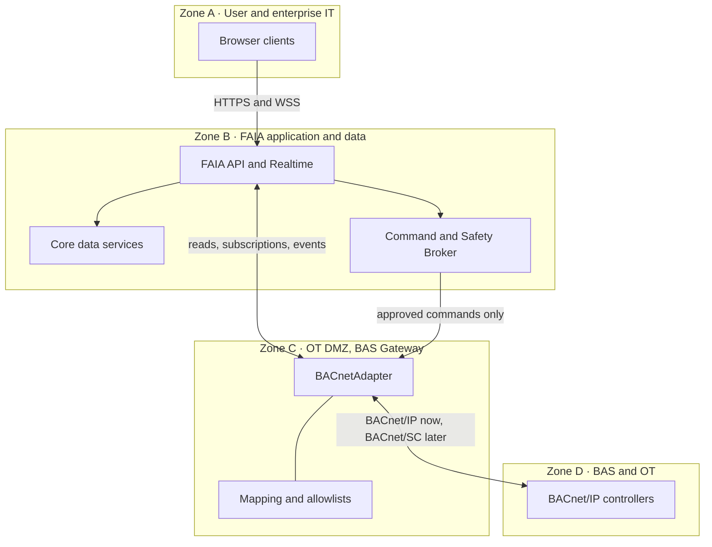

# BACnetAdapter Specification

Oct 1, 2026

## Purpose and scope

The BACnetAdapter is the generic BACnet/IP implementation of the common FAIA BAS adapter contract, and the first real adapter planned to replace the simulator. It gives FAIA cross-vendor point discovery, reads, change-of-value (COV) subscriptions, history, alarms and gated commands without upper layers knowing anything about BACnet.

Requirements in this spec come from the FAIA Master Architecture & Design Record v1.0 (August 17, 2026), mainly sections 10.7, 13, 14.7, 15 and 31. The mapping of contract methods to specific BACnet services is a proposal added here; the record does not define it.

**In scope**

- Implementing every method of the common adapter contract against BACnet/IP devices.
- Reporting capabilities per source rather than assuming them.
- Translating BACnet device, object and property references to canonical FAIA points through versioned mapping data.
- Executing approved commands with explicit priority, relinquish and readback behavior.
- Keeping the design ready for BACnet/SC under the same contract.

**Out of scope**

- Command policy, approval and risk decisions. These belong to the Command & Safety Broker.
- Native vendor APIs (Metasys, Desigo, Distech). These are separate adapters.
- Controller configuration or control-sequence changes (risk class R4) and anything touching safeties or life-safety logic (R5).
- Production VLAN, firewall and OT DMZ design, which is an institutional network and security decision.

## Architectural context

The BACnetAdapter runs inside the BAS Gateway in the OT DMZ (Zone C) and is the only FAIA component that sends or receives BACnet traffic.

Reads and events pass between the FAIA API and the adapter; writes reach it only through the Command & Safety Broker.

- Browsers talk HTTPS and WSS to Zone B and never send native BACnet to Zone D.
- Core services, analytics and AI workers request BAS data through the canonical adapter interface and hold no BACnet connectivity.
- The gateway exposes the canonical interface northbound and uses only the required southbound protocols and addresses.
- The BAS keeps operating if FAIA or the gateway is unavailable, and FAIA never defeats local or equipment safety logic.

## Adapter contract

The BACnetAdapter implements all 15 methods of the common BAS adapter interface (record section 13.1) with the same semantics as the SimulatorAdapter. Upper FAIA layers call the interface only and never branch on vendor name.

The third column is the proposed BACnet realization. It is not in the record and needs confirmation during design.

| Method | Required behavior | Proposed BACnet service |
| --- | --- | --- |
| `connect()` | Open the session to the configured source and bind the allowed device list. | Bind local BACnet/IP port; register as foreign device with a BBMD where needed |
| `disconnect()` | Cancel subscriptions and release the session cleanly. | Cancel COV subscriptions; unregister foreign device |
| `health()` | Report source reachability and subscription health separately. A live connection does not prove subscriptions are healthy. | Periodic read of device System_Status; per-subscription last-notification age |
| `discover_devices()` | List devices on the allowlisted networks. | Who-Is / I-Am |
| `discover_points()` | List objects on a device with type, instance, name, units and writability. | Read of Object_List, then ReadPropertyMultiple per object |
| `read_current()` | Return one value with source status and timestamp. | ReadProperty of Present_Value and Status_Flags |
| `read_multiple()` | Return many values in one efficient call where supported. | ReadPropertyMultiple, with fallback to single reads |
| `read_history()` | Return source trend data where the device holds any. | ReadRange on Trend Log objects |
| `subscribe_changes()` | Deliver value changes as events and keep sampling semantics. | SubscribeCOV, with polling fallback |
| `unsubscribe_changes()` | Stop delivery for a point. | SubscribeCOV cancellation |
| `list_alarms()` | Return active alarms with source identifiers preserved. | GetEventInformation; event notifications |
| `acknowledge_alarm()` | Acknowledge at the source, or report the capability as false. Never fake success. | AcknowledgeAlarm |
| `execute_command()` | Execute an approved command from the Command & Safety Broker only. | WriteProperty to Present_Value at the authorized priority |
| `release_command()` | Relinquish a previous command. | WriteProperty of NULL at the same priority |
| `get_capabilities()` | Return the capability set for this source. | Derived from Protocol_Services_Supported and discovery results |

Errors map to the common adapter error model so that timeouts, rejected requests and unsupported services look the same from any adapter. A failure in this adapter degrades only its own sources; GIS, documents, history and other vendor adapters keep running.

## Capability discovery

The adapter reports seven capability flags per source, and upper services adapt to them instead of assuming what a BACnet device can do. A generic BACnet device may support COV but hold no trend history, for example.

| Capability | Meaning | How the BACnetAdapter decides |
| --- | --- | --- |
| `supports_cov` | Source can push event-driven point changes. | Device advertises SubscribeCOV and a test subscription succeeds |
| `supports_batch_read` | Efficient multi-point reads are available. | Device advertises ReadPropertyMultiple |
| `supports_history` | Source trend retrieval exists. | Trend Log objects found and ReadRange advertised |
| `supports_alarm_subscription` / `acknowledge` | Native alarms can be normalized and acknowledged. | Event services advertised; acknowledge reported separately |
| `supports_commands` | Commands can run through this adapter at all. | False until the write enablement gate is passed for that source |
| `supports_priority_array` / `release` | Priority and relinquish semantics apply. | Target object exposes Priority_Array |
| `supports_secure_transport` | An approved secure transport mode is available. | False for BACnet/IP; true only for an approved BACnet/SC path |

A capability that is false is reported as false. The adapter does not emulate a missing function, with one exception: polling may stand in for COV, and the resulting data is labeled as polled.

## Canonical mapping

Every BACnet object the adapter exposes is bound to a canonical FAIA point through a versioned mapping record, and northbound messages carry only canonical identity. BACnet device and object identifiers stay inside the adapter as source references.

Example from the record: `device 12001 / analog-input 37` maps to the FAIA point definition Supply Air Temperature Measurement on its AHU asset.

Each mapping record holds:

- Canonical point: FAIA `point_id` / `point_code`, and the asset `entity_id` / `asset_code`.
- Source: `source_system`, `adapter_id`, BACnet device instance, object type, object instance, property, native object name.
- Units: source unit, canonical unit, conversion rule.
- Value rules: enumeration or state map, scale, offset, timestamp handling.
- Quality: how BACnet Status_Flags and Reliability map to canonical quality (good, stale, missing, substituted, overridden).
- Telemetry: sampling method, COV configuration, expected update interval, stale threshold.
- Control: writable flag, command priority and release rules.
- Governance: mapping version, effective dates, provenance, approval status.

Rules:

1. Mappings are configuration data under change control. They are never hard-coded in the adapter, UI or analytics.
2. A renamed object or replaced controller updates the mapping and keeps the canonical point and its history.
3. A reused object instance whose physical function changed gets a new canonical point after engineering review.
4. An unmapped object can appear in discovery results but produces no telemetry and accepts no commands.

## Data acquisition

COV is the preferred acquisition method wherever the device and project standards support it; polling and source history fill the gaps. The adapter labels every sample with how it was obtained and never merges the methods into one indistinguishable stream.

- **COV.** Subscribe per mapped point, renew subscriptions before they lapse, and re-establish all of them after a reconnect or controller restart.
- **Polling.** Used where COV is unavailable or unreliable, at the interval set in the mapping record, using batch reads where supported.
- **History.** Retrieved from source trend objects where they exist. Where they do not, `supports_history` is false and FAIA relies on its own stored telemetry.
- **Quality.** Each sample carries source status, canonical quality and a timestamp. A point with no update inside its stale threshold is marked stale even if the connection is up.
- **Delivery.** Events may be delivered more than once, so each carries enough identity for consumers to drop duplicates. Ordering is guaranteed per point, not across points.
- **Alarms.** Native alarm states convert to the canonical alarm lifecycle. Source alarm identifiers are kept for acknowledgement and troubleshooting.

The adapter must behave correctly under COV storms, duplicate notifications, out-of-order timestamps, controller restarts and stale subscriptions.

## Commands

The adapter is read-only by default and accepts a write only from the Command & Safety Broker, for a point in the writable-point registry, after the write enablement gate is passed. The broker decides whether a command is allowed; the adapter decides how the approved intent becomes a BACnet write.

**Division of responsibility**

| Concern | Owner |
| --- | --- |
| Identity, role, scope, allowlist, risk class, range, delta, rate, interlocks, approval | Command & Safety Broker |
| Target object, property, data type, priority, relinquish, readback | BACnetAdapter |

**Execution rules**

1. The broker passes a canonical CommandIntent. The adapter resolves it to a BACnet object, property, data type and priority from the mapping record.
2. Each command definition names the one priority it may write at. The adapter refuses any other priority, because a wrong priority can override schedules, operator commands or other control logic.
3. After a write, the adapter reads the value back and reports confirmed or failed.
4. If the connection fails after a write may have been sent, the command state becomes `UNCERTAIN`. The adapter does not retry. It reads back, establishes the actual state, and returns that to the broker, which decides whether a new command is permitted.
5. `release_command()` relinquishes at the same priority the command was written at. Commands with a timeout or `auto_relinquish` are released when the lease expires.
6. If a local operator or higher-authority BAS source takes over the point, the adapter reports the conflict so FAIA can relinquish instead of fighting the BAS.
7. Every command, readback and release is written to the audit record.

**Limits**

- Risk classes R4 (sequence or configuration change) and R5 (safeties, fire and life-safety, protection logic) are never executed through the adapter.
- An AI service cannot call the command endpoint. A qualified human converts a recommendation into a CommandIntent first.
- A FAIA or adapter failure must leave the normal BAS control sequence intact.

**Write enablement gate.** Before any live write, the project identifies the approved building, system and points, network path, BAS operations authority, user roles, writable registry, risk classification, priority and release behavior, readback, audit retention, test evidence, emergency disable method and rollback procedure. The same command is exercised first against the simulator and, where possible, an isolated test controller.

## Transport and security

The first release targets BACnet/IP, and BACnet/SC must fit later under the same contract without changing it. Transport is therefore a replaceable layer inside the adapter, and nothing above it may assume UDP or broadcast.

- **Credentials.** BACnet connectivity and any credentials live only in the BAS Gateway. Browsers, Core services, analytics and AI never receive them.
- **Allowlists.** The gateway holds explicit allowlists of source systems, devices and permitted command capabilities. Southbound traffic uses only approved source, destination, protocol and port rules.
- **Read before write.** Read-only integration deploys first. Write configuration is enabled per source only after operational authorization and command-safety policy are in place.
- **Service identity.** Northbound calls to the adapter require an authenticated, authorized service identity. Network reachability is not authorization.
- **Secrets.** Nothing is hard-coded. The prototype may use simpler secret storage than the future production secrets manager.
- **Compensation.** BACnet/IP has no native authentication or encryption, so the weakness is contained by gateway isolation and application-side policy rather than passed upward.

The adapter maintains a security capability profile for each source: authentication method, service-account needs, TLS and certificate support, BACnet/IP or BACnet/SC behavior, writable object exposure, command priority, logging availability, supported software versions and patch practice. The profile informs firewall rules, secret rotation and adapter certification.

## Deployment and packaging

The adapter lives at `adapters/bacnet/` in the FAIA monorepo, builds on the shared `adapters/bas-core/` contract package, and runs inside the BAS Gateway in the OT DMZ.

- **Native first.** The gateway is deployed natively until protocol testing shows a container works. BACnet UDP and broadcast behavior is sensitive to host networking.
- **Not dual-homed for general use.** The gateway must not become a generic remote shell or a broad bridge between enterprise and BAS networks.
- **Configuration.** Source definitions, allowlists and mapping versions are external configuration, not code.
- **Observability.** The adapter emits metrics for connection state, subscription count and health, notification rate, read latency, error counts and command outcomes, using OpenTelemetry-compatible instrumentation.
- **CI.** Ordinary CI runs against the simulator only. Real-protocol tests run on an approved self-hosted runner in an isolated test environment, when authorized.

## Testing and acceptance

The adapter is accepted when it replaces the SimulatorAdapter with no changes to browser components, analytics logic or canonical data contracts (system experiment SE-02).

| Test | What it proves |
| --- | --- |
| Adapter conformance | Same contract tests as every adapter: connect and disconnect, discovery, current reads, history, subscriptions, alarms, commands where enabled, error mapping, reconnect, stale data, duplicate and out-of-order events, capability reporting |
| Adapter swap (SE-02) | Simulator and one real BACnet path run through the same interface with no upper-layer code changes |
| COV stress (SE-03) | Capacity at staged rates of 1,000, 10,000, 50,000 and 100,000 simulated points, normal and burst profiles |
| Network failure (SE-04) | Repeated disconnect and reconnect restores every subscription and marks data stale in between |
| Command safety | Priority enforcement, readback, `UNCERTAIN` handling without blind retry, relinquish, lease expiry, conflict detection |
| Security | Direct calls to the adapter that bypass the broker or lack a service identity are denied |
| Fault isolation | An adapter crash or hung source degrades only that source |

Real-device testing starts read-only against an isolated test controller or approved safe environment. Write tests follow only after the write enablement gate.

## Open items and assumptions

The record leaves these undecided, and each affects the adapter design.

- [ ] **OAI-011, final BAS vendor integration modes.** Current direction is generic BACnet where practical with native APIs as enhancements. Which sites use the BACnetAdapter instead of a vendor adapter?
- [ ] **OAI-012, BACnet/SC adoption timing.** Depends on Texas State platform alignment and operations requirements.
- [ ] **First real target.** The record names the Central Plant (Johnson Controls) and Round Rock (Siemens) as integration targets but does not pick the first BACnet device or test controller.
- [ ] **Network path.** VLAN, firewall, BBMD or foreign-device arrangement, and the gateway's BACnet device instance need approval from Texas State networking, information security and BAS operations.
- [ ] **Implementation language and BACnet stack.** Not stated in the sections reviewed for this spec.
- [ ] **Source history depth.** Whether source trend logs are read at all, or FAIA stores its own telemetry from day one.

Assumptions made in this spec that are not in the record:

- The BACnet service named for each contract method.
- How each capability flag is determined from the device.
- Unmapped objects appear in discovery but produce no telemetry and accept no commands.
- The list of adapter metrics.

## Source

FAIA Master Architecture & Design Record v1.0, Texas State University, August 17, 2026. Sections 5.1, 10.7 to 10.8, 13.1 to 13.13, 14.2, 14.7, 15.3 to 15.10, 17.10, 31.2, open items OAI-011 and OAI-012, and Appendix I.
